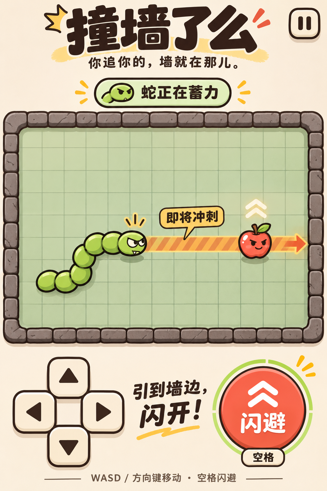

# 视觉设计

进阶版统一为废弃试验场：青绿色机器人「阿零」、深蓝灰格地与墙、橙色正式危险通道、字母配对门/踏板、紫色信标。角色身份同时用轮廓与图案区分：圆角箭头冲锋者、闪电纹方形截击者、菱形探头侦察者。

界面优先地图与双手操作空间。电量、信标倒计时和实际/待执行门状态都显示文字，颜色不是唯一提示。首页和结算使用仓库内 SVG 插画；对局用 Phaser 程序绘制，无外部素材依赖或在线字体请求。

[实际运行截图](../testing/README.md) 作为本轮视觉验收。减少动态效果设置可关闭插值及震屏。

## 历史概念图

该图是旧版苹果/绿蛇主题的 imagegen 概念图，仅保留作历史参考。它不是游戏截图，不代表当前角色、颜色、技能或操作布局，也没有将概念图裁切作为进阶版素材。
